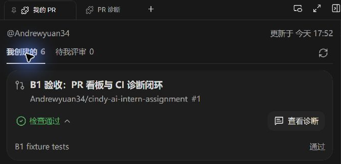
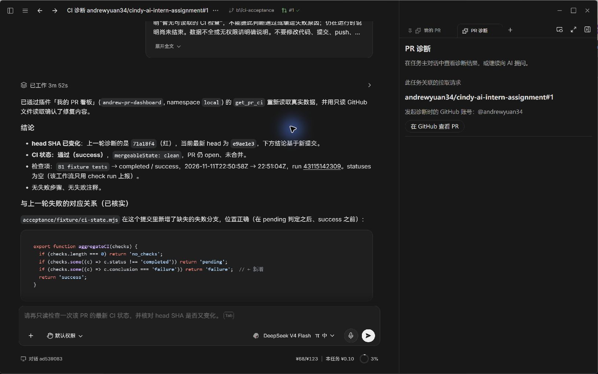

# Cindy AI 工程实习生笔试

本仓库保存笔试的文档与实现材料。

## 内容

- [Part 0(a)：项目导览](docs/part0-a-project-guide.md) — 主要模块、插件能力及阅读过程。
- [Part 0(b)：每日单词卡需求分析](docs/part0-b-word-card-design.md) — 模型接入、用户配置及直接调用 OpenAI 接口方案的评估。
- [Part B(B1)：我的 PR 看板插件](plugins/pr-dashboard/README.md) — 交付源码 0.1.3，精简面板与静态 Lucide 图标；61 项行为测试通过，已完成 Forge 更新安装、真实 UI 与原任务导航验证。0.1.1 的真实失败诊断、修复绿灯及原任务复用闭环保留为历史证据，0.1.2 已验证无检查场景诊断。
- [Part B(B1)：做出来——实现与协作说明](docs/part-b1-implementation-review.md) — 做了什么、卡在哪，以及如何指挥 Agent 检查和解决问题。

## B1 运行截图

以下两张为 Cindy 中的真实运行截图。点击图片可查看原图。

**PR 看板（插件 0.1.3）**：公开验收 PR、CI 状态、“查看诊断”入口及展开的检查明细。截图裁取公开 PR 区域。

**AI 接手诊断（插件 0.1.1 验收记录）**：同一诊断任务对照失败与修复后的提交，确认新的 CI 运行通过；右侧保留对应 PR。完整失败到修复的验证在 0.1.1 完成，0.1.3 继续验证了新版界面和原任务导航。

[完整验证记录与明暗主题演示](plugins/pr-dashboard/IMPLEMENTATION.md) · [全部截图文件](plugins/pr-dashboard/screenshots)

明暗主题演示图使用模拟数据，已在验证记录中单独标注。

## 参考项目与验证范围

参考项目：[makecindy/cindy](https://github.com/makecindy/cindy)。源码阅读版本固定为 [`4ac45b894ef89459681367ec1330839a93243d1e`](https://github.com/makecindy/cindy/tree/4ac45b894ef89459681367ec1330839a93243d1e)，文内源码链接均指向该版本。
