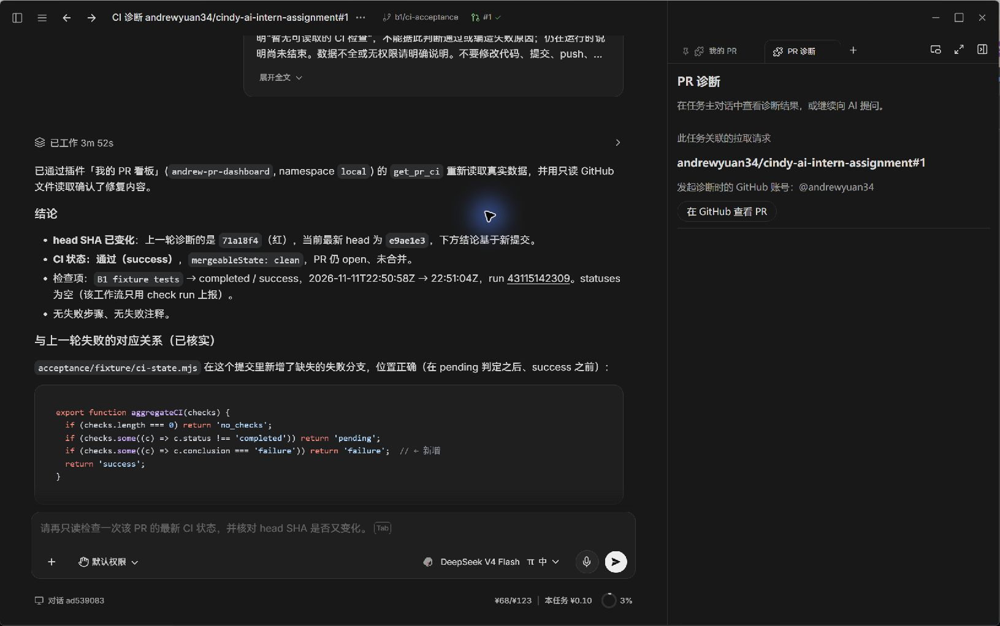
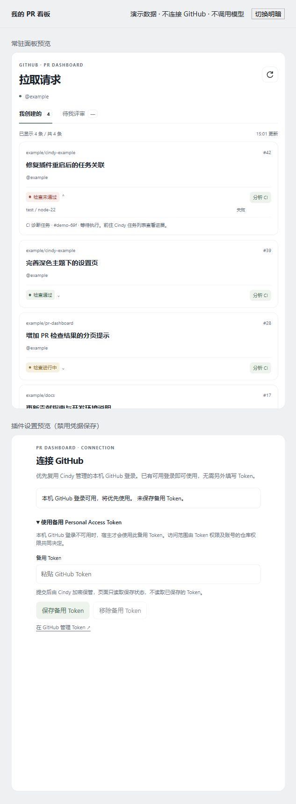
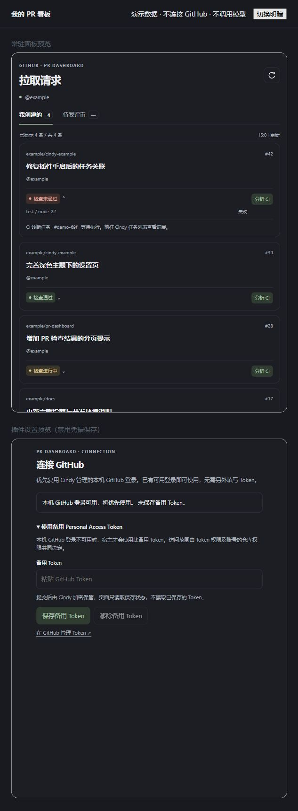

# B1 实施与验证记录

当前交付源码为 **0.1.2**；完整实机验收证据来自 **0.1.1 / Cindy 0.1.126**。0.1.2 仅调整诊断提示词，补充三项证据边界：成功检查未采集 annotations 不表示缺陷，`no_checks` 不表示历史从未运行，CI 状态不能直接推出分支保护结论。该版本本地 61 项测试再次通过；以下安装记录仍以实际验收的 0.1.1 为准。

## 已确定的范围

- 常驻面板为主；我创建的、待我评审的两个未关闭 PR 列表。
- 复用 gh 登录，备用 PAT 由 Cindy vault 保管。
- 每个 PR 独立诊断任务，同账号同 PR 继续原任务。
- “查看诊断”原生导航到该任务，任务页显示关联 PR。
- 打开面板、返回前台、手动操作触发刷新；不定时轮询。
- 默认插件图标。

交付不包含 webhook 服务或 Node Worker。

## 关键实现

面板没有 Cindy 桥接权限，先通过 `/wake` 唤醒主逻辑，再用 BroadcastChannel 传递带请求 ID 的命令。主逻辑先登记请求，再执行异步操作；面板重发同 ID 只获取同一结果。面板只渲染纯文本与经过检查的 GitHub 链接。

GitHub 读取全部经过 `cindy.fetch`，只声明 `api.github.com`。每插件统一限制两条在途请求。分别读取 check-runs 与 commit statuses；部分端点失败仍保留其他数据，但不把不完整结果标成通过。诊断前重新读取 PR 的 head SHA，以免把旧提交的失败当成新提交的问题。

任务 API 的成功返回值就是任务或运行数据，并非 `{ok:true}` 包装。`create` 只建任务，`send` 才派发。创建和发送前保存请求键；未知回执重试沿用完全相同的 payload，包括 `expectedRevision`。再次诊断前读取当前任务 revision，保留原任务关联，不自动提升权限或切换模型。

“查看诊断”使用独立的点击请求：从当前 PR 关联立即取得 taskId，调用 `cindy.taskView({sessionId, focus:true})`，检查 `ok`、`focusRequested` 和返回任务编号。导航请求限时 2.5 秒，不先读取 GitHub 或查询任务状态；同 ID 的消息重传只执行一次。宿主仍负责校验真实点击。任务页只读已保存的 PR 关联，不新建任务、不发送模型消息。

任务资料明确标成不可信外部数据，并限制总字节数。提示词优先要求使用本插件 `get_pr_ci` 获取当前 PR 的检查、步骤与注释，必要时再读取相关测试和源码。KV 不保存凭据，只有配置和账号隔离的任务关联；保留待确认请求以便安全恢复。所有写入串行执行，读取或写入失败均不以空对象覆盖旧状态。同实例更新保留这些关联。

## 兼容依据

最低版本为 **Cindy 0.1.126**。该版本已实际完成本插件 0.1.1 的 Forge 整包安装更新、gh 凭据复用、普通任务创建和 `taskView` 点击导航验证。运行时仍检查 `tasks.capabilities()`；旧宿主缺少操作或未确认导航回执时明确报错，不声称已成功跳转。

## 本地验证

2026-11-11 验证结果：

- `node --test tests/*.test.mjs`：61 项通过，0 失败。覆盖 PR 查询与分页、CI 聚合、网络/权限/截断错误、两条并发上限、账号切换竞态、串行 KV、任务重复点击与跨重启回执恢复、冷启动提前到达的工具调用、消息重试及唤醒失败，以及导航期限、回执校验、重复导航去重、只读任务上下文和普通 RPC 超时兼容。时间相关测试使用假计时器，不靠固定长等待。
- `main.js`、`panel.js`、`settings.js` 及测试模块语法检查通过。
- 用固定源码中的官方 `validateGhostManifest` 校验器验证清单，通过；清单校验与下面的真实 Forge 整包验证分别记录。
- 本地演示验证列表切换、展开 CI、模拟诊断交接、备用 PAT 设置展开及明暗主题。模拟结果与下列真实宿主和模型验收分别记录。

## 真实 Cindy 验收

2026-11-11，在 Cindy 中国大陆版 0.1.126 中已观察到：

- 插件 **0.1.1** 经 `ghost_forge_pack` 正式打包，`ghost_forge_install` 返回 `updated`；原实例 `_ns__local__andrew-pr-dashboard` 保持启用。
- 复用宿主 gh 登录账号 `Andrewyuan34`，新面板真实显示 **6 条我创建的 PR、0 条待我评审的 PR**。
- 验收 PR [andrewyuan34/cindy-ai-intern-assignment#1](https://github.com/andrewyuan34/cindy-ai-intern-assignment/pull/1) 的 [CI run 43112754721](https://github.com/andrewyuan34/cindy-ai-intern-assignment/actions/runs/43112754721) 显示红色失败 `B1 fixture tests`，可展开失败检查；失败证据包含 `Verify CI state aggregation` 步骤和 `ci-state.mjs:9` 的 `Expected failure but received success` 注释。
- 点击“分析 CI”创建任务 `ad539083-73e9-434f-8b1e-635b7dc72480`。真实点击“查看诊断”成功切到该任务，任务页正确显示上述 PR 关联；主对话已收到最新提交与失败步骤、注释资料。
- PR 外链经 Cindy 确认后实际由 Chrome 打开，页面标题与 URL 均对应验收 PR #1。
- 原诊断任务中的 AI 已调用本插件 `get_pr_ci` 并读取测试与源码，最终准确指出验收样本遗漏 `conclusion === 'failure'` 分支，定位 `ci-state.mjs:9`。
- 验收样本仅补上该分支，修复提交为 [`e9ae1e364076f85c4b0a75103f0edb226b3140e5`](https://github.com/Andrewyuan34/cindy-ai-intern-assignment/commit/e9ae1e364076f85c4b0a75103f0edb226b3140e5)。[成功 CI run 43115142309](https://github.com/Andrewyuan34/cindy-ai-intern-assignment/actions/runs/43115142309) 的 **4 项测试全部通过**；Cindy 看板已实测绿色检查通过，展开的 `B1 fixture tests` 链接对应新 run。旧失败 run 保留，便于前后对照。
- 点击“重新分析”后复用原任务 `ad539083-73e9-434f-8b1e-635b7dc72480`，最终输出明确对照旧提交 `71a18f4` 的失败与新提交 `e9ae1e3` 的通过，引用成功 run `43115142309`，读取新源码确认已补充 failure 分支，并确认验收测试文件的 blob 未变。同 PR 任务复用已通过实机验证。

## 验证范围

0.1.1 已完成真实失败 CI → AI 定位原因 → 修复后看板绿灯 → 原任务重新分析确认修复的闭环。本地 61 项行为测试与验收样本 CI 的 4 项测试是不同测试集。权限不足、运行中状态及其他错误分支由本地测试覆盖；备用 PAT 保存流程未使用真实凭据演练，未对所有账号、权限组合与运行情形逐一实测。

## 真实宿主截图

插件 0.1.1 在 Cindy 0.1.126 中的闭环验收：同一任务对照前后提交，确认新 CI run 通过、修复源码及关联 PR。

## 本地演示截图

截图是演示数据，顶部标有“不连接 GitHub · 不调用模型”；不能作为真实 Cindy 安装或模型执行的证明。

正式 `.cindy` 包使用 Cindy Forge 生成。上方真实安装与模型运行记录对应 0.1.1；插件未发布到插件市场。

## 参考

- [Cindy 插件作者手册](https://github.com/makecindy/cindy/tree/4ac45b894ef89459681367ec1330839a93243d1e/apps/desktop/resources/system-skills/cindy-plugin-creator)
- [GitHub 搜索 API](https://docs.github.com/en/rest/search/search)
- [检查运行 API](https://docs.github.com/en/rest/checks/runs)
- [提交状态 API](https://docs.github.com/en/rest/commits/statuses)
- [Actions 工作流任务 API](https://docs.github.com/en/rest/actions/workflow-jobs)
